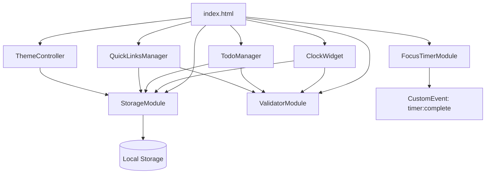

# Design Document — To-Do Life Dashboard

## Overview

To-Do Life Dashboard adalah aplikasi web satu halaman (*Single-Page Application*) yang dibangun murni dengan HTML5, CSS3, dan Vanilla JavaScript ES6+. Tidak ada framework, tidak ada build tool, tidak ada server — aplikasi berjalan langsung di browser dan menyimpan seluruh data di Browser Local Storage API.

Arsitektur mengikuti pola **Module Pattern** berbasis IIFE dan modul ES6 (`type="module"`) sehingga setiap komponen terisolasi namun dapat berkomunikasi melalui antarmuka yang terdefinisi. Tidak ada dependensi eksternal; semua kode dikelola dalam tiga file:

| File | Tanggung Jawab |
|---|---|
| `index.html` | Struktur HTML semantik, titik masuk aplikasi |
| `css/style.css` | Seluruh gaya, variabel CSS tema, media query |
| `js/script.js` | Seluruh logika aplikasi, semua modul |

### Tujuan Desain

1. **Keandalan data** — data tidak pernah hilang karena kesalahan serialisasi.
2. **Kecepatan muat** — tidak ada request jaringan; semua aset lokal.
3. **Kemudahan pemeliharaan** — setiap fitur adalah modul mandiri yang hanya berinteraksi melalui `StorageModule` dan event DOM.
4. **Aksesibilitas** — elemen semantik, label ARIA, kontras WCAG 2.1 AA.

---

## Architecture

### Gambaran Besar

```
index.html
  └── <script type="module" src="js/script.js">
        ├── StorageModule          (baca/tulis Local Storage)
        ├── ValidatorModule        (validasi input)
        ├── ClockWidget            (jam, tanggal, sapaan, nama pengguna)
        ├── FocusTimerModule       (countdown 25 menit)
        ├── TodoManager            (CRUD tugas)
        ├── QuickLinksManager      (CRUD tautan cepat)
        ├── ThemeController        (toggle light/dark mode)
        └── App.init()             (titik masuk, inisialisasi semua modul)
```

### Prinsip Modul

- Setiap modul diekspor sebagai object literal (`const ModuleName = { ... }`).
- Modul tidak memanggil satu sama lain secara langsung kecuali `StorageModule` dan `ValidatorModule` yang bersifat *utility shared*.
- Komunikasi antar-modul menggunakan **DOM Events** (dispatchEvent / addEventListener) bila diperlukan, misalnya timer selesai memanggil notifikasi.
- Semua manipulasi DOM dilakukan via `document.getElementById` / `querySelector` — tidak ada virtual DOM.

### Alur Inisialisasi

```
DOMContentLoaded
  ├── ThemeController.init()   ← pertama, cegah FOUC
  ├── StorageModule.check()    ← cek ketersediaan Local Storage
  ├── ClockWidget.init()
  ├── FocusTimerModule.init()
  ├── TodoManager.init()
  └── QuickLinksManager.init()
```

`ThemeController.init()` harus dipanggil paling awal karena menerapkan class CSS tema sebelum browser merender elemen lain, mencegah *Flash of Unstyled Content* (FOUC).

### Diagram Alur Komponen



---

## Components and Interfaces

### StorageModule

Lapisan abstraksi tunggal untuk semua operasi Local Storage. Tidak ada modul lain yang memanggil `localStorage` secara langsung.

```js
const StorageModule = {
  KEYS: {
    TODOS:    'tld_todos',
    LINKS:    'tld_links',
    USERNAME: 'tld_username',
    THEME:    'tld_theme',
  },

  isAvailable(): boolean,
  // Mengembalikan true jika localStorage dapat ditulis; false jika diblokir/tidak tersedia.

  get(key: string, defaultValue: any): any,
  // Membaca dan meng-parse JSON dari localStorage[key].
  // Jika key tidak ada atau parse gagal, kembalikan defaultValue.

  set(key: string, value: any): boolean,
  // Serialisasi value ke JSON dan simpan ke localStorage[key].
  // Kembalikan true jika berhasil, false jika gagal (mis. QuotaExceededError).

  showUnavailableWarning(): void,
  // Tampilkan banner peringatan di atas halaman jika localStorage tidak tersedia.
}
```

### ValidatorModule

Kumpulan fungsi validasi murni (tanpa efek samping).

```js
const ValidatorModule = {
  isBlank(str: string): boolean,
  // true jika str kosong atau hanya spasi.

  exceedsMaxLength(str: string, max: number): boolean,
  // true jika str.trim().length > max.

  isDuplicateTodo(text: string, todos: TodoItem[], excludeId?: string): boolean,
  // true jika text (case-insensitive, trimmed) cocok dengan todo yang belum selesai,
  // mengabaikan item dengan id === excludeId.

  isValidUrl(url: string): { valid: boolean; normalizedUrl: string },
  // Validasi URL: harus http:// atau https://, atau domain dengan titik (auto-prefix https://).
  // Kembalikan { valid: true, normalizedUrl } jika valid.

  isDuplicateLink(url: string, links: QuickLink[]): boolean,
  // true jika url (case-insensitive) sudah ada di links.

  exceedsUrlMaxLength(url: string): boolean,
  // true jika url.length > 2048.
}
```

### ClockWidget

```js
const ClockWidget = {
  init(): void,
  // Pasang interval 1 detik, muat username dari storage, render awal.

  _tick(): void,
  // Perbarui tampilan jam, tanggal, sapaan setiap detik.

  _getGreeting(hour: number): string,
  // 05–11 → "Selamat Pagi", 12–14 → "Selamat Siang",
  // 15–17 → "Selamat Sore", 18–04 → "Selamat Malam".

  _formatTime(date: Date): string,
  // HH:MM:SS zero-padded.

  _formatDate(date: Date): string,
  // "Jumat, 17 Oktober 2026" (Bahasa Indonesia).

  enableEditMode(): void,
  disableEditMode(): void,
  saveUsername(name: string): void,
}
```

### FocusTimerModule

```js
const FocusTimerModule = {
  DURATION_SECONDS: 1500,  // 25 * 60

  init(): void,
  start(): void,
  stop(): void,
  reset(): void,

  _tick(): void,
  // Hitung sisa waktu berdasarkan (endTimestamp - Date.now()), bukan decrement naif.

  _formatDisplay(seconds: number): string,
  // "MM:SS" zero-padded.

  _onComplete(): void,
  // Hentikan timer, tampilkan notifikasi, dispatch CustomEvent 'timer:complete'.
}
```

State internal timer:

| Properti | Tipe | Keterangan |
|---|---|---|
| `_intervalId` | number\|null | ID dari `setInterval` yang aktif |
| `_endTimestamp` | number\|null | `Date.now() + remainingMs` saat Start ditekan |
| `_remainingSeconds` | number | Detik tersisa saat timer dihentikan |
| `_isRunning` | boolean | Status timer |

### TodoManager

```js
const TodoManager = {
  init(): void,
  _render(): void,

  addTodo(text: string): void,
  toggleTodo(id: string): void,
  editTodo(id: string, newText: string): void,
  deleteTodo(id: string): void,

  _createTodoItem(text: string): TodoItem,
  // Buat objek TodoItem baru dengan id = crypto.randomUUID() atau timestamp fallback.

  _saveToStorage(): void,
  _loadFromStorage(): TodoItem[],
}
```

### QuickLinksManager

```js
const QuickLinksManager = {
  MAX_LINKS: 20,

  init(): void,
  _render(): void,

  addLink(label: string, url: string): void,
  deleteLink(id: string): void,

  _createQuickLink(label: string, url: string): QuickLink,
  _saveToStorage(): void,
  _loadFromStorage(): QuickLink[],
}
```

### ThemeController

```js
const ThemeController = {
  init(): void,
  // Baca tema dari storage, terapkan class, perbarui ikon tombol.

  toggle(): void,
  // Ubah tema, simpan ke storage, perbarui ikon.

  _apply(theme: 'light' | 'dark'): void,
  // Tambahkan/hapus class 'dark-mode' pada <html>.

  _updateIcon(theme: 'light' | 'dark'): void,
}
```

---

## Data Models

### TodoItem

```js
/**
 * @typedef {Object} TodoItem
 * @property {string}  id        - UUID unik (crypto.randomUUID() atau Date.now().toString(36))
 * @property {string}  text      - Teks tugas, 1–200 karakter
 * @property {boolean} completed - Status penyelesaian
 * @property {number}  createdAt - Unix timestamp (ms) saat item dibuat
 */
```

Contoh nilai yang tersimpan di `tld_todos`:

```json
[
  {
    "id": "a1b2c3d4",
    "text": "Belajar JavaScript",
    "completed": false,
    "createdAt": 1729123456789
  }
]
```

### QuickLink

```js
/**
 * @typedef {Object} QuickLink
 * @property {string} id        - UUID unik
 * @property {string} label     - Label tampilan, 1–50 karakter
 * @property {string} url       - URL lengkap dengan skema, maks 2048 karakter
 * @property {number} createdAt - Unix timestamp (ms) saat link dibuat
 */
```

Contoh nilai yang tersimpan di `tld_links`:

```json
[
  {
    "id": "x9y8z7w6",
    "label": "GitHub",
    "url": "https://github.com",
    "createdAt": 1729123456000
  }
]
```

### Storage Keys Summary

| Kunci | Tipe nilai | Default |
|---|---|---|
| `tld_todos` | `TodoItem[]` JSON | `[]` |
| `tld_links` | `QuickLink[]` JSON | `[]` |
| `tld_username` | `string` JSON | `""` |
| `tld_theme` | `"light"` \| `"dark"` JSON | `"light"` |

### Skema HTML Widget

Setiap widget memiliki elemen container dengan ID yang stabil untuk digunakan oleh JavaScript:

```html
<html lang="id" class="light-mode">
<head>...</head>
<body>
  <div id="storage-warning" hidden>...</div>  <!-- Banner peringatan localStorage -->

  <header>
    <div id="clock-widget">
      <time id="clock-time"></time>
      <p id="clock-date"></p>
      <p id="clock-greeting">
        <span id="greeting-text"></span>
        <button id="username-display"></button>  <!-- klik → edit mode -->
      </p>
      <div id="username-edit" hidden>
        <input id="username-input" type="text" maxlength="50" aria-label="Nama pengguna">
        <button id="username-save">Simpan</button>
        <button id="username-cancel">Batal</button>
      </div>
    </div>
    <button id="theme-toggle" aria-label="Ganti tema">☀️</button>
  </header>

  <main>
    <section id="focus-timer-section" aria-label="Focus Timer">
      <div id="timer-display">25:00</div>
      <div id="timer-notification" hidden role="alert"></div>
      <button id="timer-start">Start</button>
      <button id="timer-stop" disabled>Stop</button>
      <button id="timer-reset">Reset</button>
    </section>

    <section id="todo-section" aria-label="To-Do List">
      <form id="todo-form">
        <input id="todo-input" type="text" maxlength="200" aria-label="Tambah tugas baru">
        <button type="submit">Tambah</button>
      </form>
      <p id="todo-warning" role="alert" hidden></p>
      <ul id="todo-list"></ul>
    </section>

    <section id="quick-links-section" aria-label="Quick Links">
      <form id="link-form">
        <input id="link-label-input" type="text" maxlength="50" aria-label="Label tautan">
        <input id="link-url-input" type="text" aria-label="URL tautan">
        <button type="submit">Tambah</button>
      </form>
      <p id="link-warning" role="alert" hidden></p>
      <ul id="link-list"></ul>
    </section>
  </main>
</body>
</html>
```

---

## CSS Architecture

### Variabel Tema (Custom Properties)

Seluruh warna, bayangan, dan transisi didefinisikan sebagai CSS custom properties di `:root` dan di-override oleh class `.dark-mode` pada `<html>`:

```css
:root {
  /* Light mode defaults */
  --bg-primary:   #f5f5f5;
  --bg-surface:   #ffffff;
  --text-primary: #1a1a1a;
  --text-muted:   #6b7280;
  --accent:       #3b82f6;
  --accent-hover: #2563eb;
  --border:       #e5e7eb;
  --shadow:       0 1px 3px rgba(0,0,0,.12);
  --transition:   200ms ease;
}

html.dark-mode {
  --bg-primary:   #111827;
  --bg-surface:   #1f2937;
  --text-primary: #f9fafb;
  --text-muted:   #9ca3af;
  --accent:       #60a5fa;
  --accent-hover: #93c5fd;
  --border:       #374151;
  --shadow:       0 1px 3px rgba(0,0,0,.4);
}
```

Seluruh komponen menggunakan variabel ini sehingga pergantian tema hanya memerlukan satu penambahan/penghapusan class tanpa mengubah gaya individual.

### Strategi Responsif

Layout menggunakan **CSS Grid** di level dashboard dan **Flexbox** di level komponen:

```
Desktop  (≥1024px): Grid 2 kolom — [Clock+Timer | Todo+Links]
Tablet   (768–1023px): Grid 2 kolom dengan kolom lebih ramping
Mobile   (<768px): Grid 1 kolom, semua section ditumpuk vertikal
```

```css
/* Mobile-first */
.dashboard-grid {
  display: grid;
  grid-template-columns: 1fr;
  gap: 1rem;
  padding: 1rem;
}

@media (min-width: 768px) {
  .dashboard-grid {
    grid-template-columns: 1fr 1fr;
  }
}

@media (min-width: 1024px) {
  .dashboard-grid {
    grid-template-columns: 380px 1fr;
    max-width: 1200px;
    margin: 0 auto;
  }
}
```

Semua elemen interaktif memiliki `min-height: 44px; min-width: 44px` untuk memenuhi WCAG 2.5.5.

### Strategi Pencegahan FOUC

`ThemeController.init()` dipanggil di dalam `<script type="module">` sebelum `DOMContentLoaded` melalui `defer`; class tema diterapkan ke `<html>` secara sinkron sebelum render pertama browser.

---

## Error Handling

### Local Storage Tidak Tersedia

```
StorageModule.isAvailable()
  └── false → StorageModule.showUnavailableWarning()
                └── tampilkan #storage-warning banner
                    aplikasi tetap berjalan tanpa persistensi
```

Semua panggilan `StorageModule.set()` diperiksa return value-nya; jika `false` (mis. `QuotaExceededError`), tampilkan toast peringatan non-blocking.

### JSON Parse Error

Semua pembacaan dari Local Storage dibungkus `try-catch`:

```js
get(key, defaultValue) {
  try {
    const raw = localStorage.getItem(key);
    if (raw === null) return defaultValue;
    return JSON.parse(raw) ?? defaultValue;
  } catch {
    return defaultValue;
  }
}
```

### Validasi Input

Setiap aksi pengguna (tambah/edit todo, tambah link, simpan username) divalidasi oleh `ValidatorModule` sebelum menyentuh storage. Pesan kesalahan ditampilkan di elemen `role="alert"` yang relevan sehingga dapat dibaca oleh screen reader.

### Timer Edge Case

Timer menggunakan `endTimestamp` (bukan decrement naif) sehingga akurat meski tab dilatarbelakangi. Jika `Date.now() > endTimestamp`, sisa waktu di-clamp ke `0` dan `_onComplete()` dipanggil.

---


## Correctness Properties

*A property is a characteristic or behavior that should hold true across all valid executions of a system — essentially, a formal statement about what the system should do. Properties serve as the bridge between human-readable specifications and machine-verifiable correctness guarantees.*

---

### Property 1: Format Waktu Selalu Valid

*For any* `Date` object, `ClockWidget._formatTime(date)` SHALL menghasilkan string dengan format tepat `HH:MM:SS` dimana HH ∈ [00–23], MM ∈ [00–59], SS ∈ [00–59], masing-masing zero-padded dua digit.

**Validates: Requirements 2.1**

---

### Property 2: Format Tanggal Bahasa Indonesia

*For any* `Date` object, `ClockWidget._formatDate(date)` SHALL menghasilkan string yang mengandung nama hari valid dalam Bahasa Indonesia (Senin/Selasa/Rabu/Kamis/Jumat/Sabtu/Minggu), angka tanggal ∈ [1–31], nama bulan valid dalam Bahasa Indonesia (Januari–Desember), dan tahun 4 digit yang cocok dengan tahun dari `Date` tersebut.

**Validates: Requirements 2.2**

---

### Property 3: Sapaan Berbasis Jam Selalu Tepat

*For any* jam (integer) dalam rentang [0–23], `ClockWidget._getGreeting(hour)` SHALL mengembalikan:
- `"Selamat Pagi"` untuk jam ∈ [5, 11]
- `"Selamat Siang"` untuk jam ∈ [12, 14]
- `"Selamat Sore"` untuk jam ∈ [15, 17]
- `"Selamat Malam"` untuk jam ∈ [18, 23] ∪ [0, 4]

*For any* jam, tepat satu sapaan dikembalikan — tidak ada celah dan tidak ada tumpang-tindih rentang.

**Validates: Requirements 2.3, 2.4, 2.5, 2.6**

---

### Property 4: Round-Trip Penyimpanan Nama Pengguna

*For any* string nama pengguna yang valid (non-blank, panjang ∈ [1, 50] setelah trim), menyimpan nama via `ClockWidget.saveUsername(name)` kemudian membacanya kembali via `StorageModule.get(KEYS.USERNAME, "")` SHALL menghasilkan string yang identik dengan nama yang disimpan.

**Validates: Requirements 2.9**

---

### Property 5: Validasi Nama Pengguna — Blank dan Panjang

*For any* string yang kosong atau hanya berisi whitespace, `ValidatorModule.isBlank(str)` SHALL mengembalikan `true` dan `ClockWidget.saveUsername()` SHALL menolak penyimpanan, mempertahankan nama sebelumnya.

*For any* string dengan panjang > 50 karakter, `ValidatorModule.exceedsMaxLength(str, 50)` SHALL mengembalikan `true` dan simpan SHALL ditolak.

**Validates: Requirements 2.10, 2.11**

---

### Property 6: Format Timer MM:SS Selalu Valid

*For any* nilai detik integer dalam rentang [0, 1500], `FocusTimerModule._formatDisplay(seconds)` SHALL menghasilkan string dengan format tepat `MM:SS` dimana nilai MM = ⌊seconds / 60⌋ dan SS = seconds % 60, keduanya zero-padded dua digit.

**Validates: Requirements 3.2, 3.8**

---

### Property 7: Round-Trip Todo List ke Local Storage

*For any* array `TodoItem[]` (termasuk array kosong), memanggil `TodoManager._saveToStorage()` kemudian `TodoManager._loadFromStorage()` SHALL menghasilkan array yang secara *deep-equal* ekuivalen dengan array yang ditulis — setiap `id`, `text`, `completed`, dan `createdAt` terjaga.

**Validates: Requirements 4.2, 4.3**

---

### Property 8: Penambahan Todo Menambah Panjang List

*For any* daftar todo yang ada dan teks tugas valid (non-blank, ≤200 karakter, tidak duplikat dengan item belum selesai), memanggil `TodoManager.addTodo(text)` SHALL menghasilkan daftar dengan panjang bertambah tepat 1 dan item baru tersebut terdapat di daftar.

**Validates: Requirements 4.1**

---

### Property 9: Todo Blank Ditolak

*For any* string yang hanya berisi whitespace (termasuk string kosong), `TodoManager.addTodo(str)` SHALL menolak penambahan dan panjang daftar todo SHALL tidak berubah.

**Validates: Requirements 4.4**

---

### Property 10: Todo Duplikat (Case-Insensitive) Ditolak

*For any* teks tugas yang sudah ada di daftar sebagai item belum selesai, setiap variasi casing (uppercase, lowercase, mixed) dari teks tersebut SHALL ditolak oleh `ValidatorModule.isDuplicateTodo()`, dan daftar todo SHALL tidak berubah.

**Validates: Requirements 4.5**

---

### Property 11: Toggle Status Todo Bersifat Idempoten dalam Pasangan

*For any* `TodoItem`, memanggil `TodoManager.toggleTodo(id)` dua kali berturut-turut SHALL menghasilkan item kembali ke status `completed` semula — toggle adalah operasi invers dari dirinya sendiri.

**Validates: Requirements 4.6**

---

### Property 12: Penghapusan Todo Menghilangkan Item dari Daftar

*For any* daftar todo yang tidak kosong dan *any* `id` item yang ada di daftar, memanggil `TodoManager.deleteTodo(id)` SHALL menghasilkan daftar yang tidak mengandung item dengan `id` tersebut, dan panjang daftar berkurang tepat 1.

**Validates: Requirements 4.11**

---

### Property 13: Validasi Edit Todo — Duplikat Kecuali Diri Sendiri

*For any* daftar todo dan *any* item yang sedang diedit, `ValidatorModule.isDuplicateTodo(newText, todos, excludeId)` SHALL mengembalikan `false` apabila `newText` cocok (case-insensitive) hanya dengan item yang memiliki `id === excludeId` — item tidak dianggap duplikat dengan dirinya sendiri.

**Validates: Requirements 4.8**

---

### Property 14: Round-Trip Quick Links ke Local Storage

*For any* array `QuickLink[]` (termasuk array kosong), memanggil `QuickLinksManager._saveToStorage()` kemudian `QuickLinksManager._loadFromStorage()` SHALL menghasilkan array yang secara *deep-equal* ekuivalen — setiap `id`, `label`, `url`, dan `createdAt` terjaga.

**Validates: Requirements 5.2, 5.3**

---

### Property 15: Penambahan Link Menambah Panjang List

*For any* daftar link yang ada (jumlah < 20) dan pasangan label/URL valid, memanggil `QuickLinksManager.addLink(label, url)` SHALL menghasilkan daftar dengan panjang bertambah tepat 1.

**Validates: Requirements 5.1**

---

### Property 16: Normalisasi URL — Domain Tanpa Skema Mendapat Prefiks https://

*For any* string URL yang mengandung karakter titik (`.`) tetapi tidak diawali `http://` atau `https://`, `ValidatorModule.isValidUrl(url).normalizedUrl` SHALL menghasilkan URL yang diawali `https://`.

*For any* string URL yang tidak mengandung titik dan tidak diawali skema valid, `ValidatorModule.isValidUrl(url).valid` SHALL mengembalikan `false`.

**Validates: Requirements 5.6**

---

### Property 17: URL Duplikat (Case-Insensitive) Ditolak

*For any* URL yang sudah ada di daftar, setiap variasi casing dari URL tersebut SHALL ditolak oleh `ValidatorModule.isDuplicateLink()`.

**Validates: Requirements 5.9**

---

### Property 18: Penghapusan Link Menghilangkan Item dari Daftar

*For any* daftar link yang tidak kosong dan *any* `id` link yang ada, memanggil `QuickLinksManager.deleteLink(id)` SHALL menghasilkan daftar yang tidak mengandung link dengan `id` tersebut, dan panjang daftar berkurang tepat 1.

**Validates: Requirements 5.7**

---

### Property 19: Anchor Quick Link Selalu Aman

*For any* `QuickLink`, elemen `<a>` yang di-render SHALL memiliki atribut `target="_blank"` dan `rel="noopener noreferrer"` untuk mencegah tab-napping.

**Validates: Requirements 5.4**

---

### Property 20: Toggle Tema Bersifat Idempoten dalam Pasangan

*For any* tema aktif (`"light"` atau `"dark"`), memanggil `ThemeController.toggle()` dua kali berturut-turut SHALL menghasilkan tema yang sama dengan tema sebelum toggle pertama.

**Validates: Requirements 6.1**

---

### Property 21: Round-Trip Penyimpanan Tema

*For any* nilai tema valid (`"light"` atau `"dark"`), menyimpan via `ThemeController._apply(theme)` → `StorageModule.set(KEYS.THEME, theme)` kemudian membaca via `StorageModule.get(KEYS.THEME, "light")` SHALL menghasilkan nilai yang identik.

**Validates: Requirements 6.2**

---

### Property 22: Round-Trip General StorageModule

*For any* nilai JavaScript yang dapat di-serialisasi (array, object, string, number, boolean, null), memanggil `StorageModule.set(key, value)` kemudian `StorageModule.get(key, null)` SHALL menghasilkan nilai yang secara *deep-equal* ekuivalen dengan nilai yang ditulis.

**Validates: Requirements 7.4**

---

### Property 23: StorageModule Menangani JSON Rusak dengan Aman

*For any* string JSON yang tidak valid yang dimasukkan langsung ke `localStorage[key]`, memanggil `StorageModule.get(key, defaultValue)` SHALL mengembalikan `defaultValue` tanpa melempar exception apapun ke atas call stack.

**Validates: Requirements 7.2**

---

## Testing Strategy

### Pendekatan Dual Testing

Strategi pengujian menggabungkan dua pendekatan yang saling melengkapi:

| Jenis | Tujuan |
|---|---|
| **Unit / Example Tests** | Memverifikasi perilaku konkret: state awal, transisi state, kasus tepi spesifik, interaksi UI |
| **Property-Based Tests** | Memverifikasi properti universal yang harus berlaku untuk semua input valid |

### Property-Based Testing

Fitur ini sangat cocok untuk property-based testing karena:
- `ValidatorModule` adalah kumpulan fungsi murni
- `StorageModule` memiliki round-trip yang jelas (serialize → deserialize)
- `ClockWidget` memiliki fungsi format murni
- `FocusTimerModule` memiliki fungsi format murni
- Logika bisnis (duplikat, validasi panjang, normalisasi URL) beroperasi di ruang input yang besar

**Library yang direkomendasikan**: [`fast-check`](https://fast-check.dev/) untuk JavaScript (tersedia via CDN atau npm).

**Konfigurasi**: Setiap property test dijalankan minimum **100 iterasi** (default fast-check adalah 100; konfigurasikan via `{ numRuns: 100 }` atau lebih tinggi untuk properti kritis).

**Tag format** per test:

```js
// Feature: todo-life-dashboard, Property 7: Round-Trip Todo List ke Local Storage
fc.assert(fc.property(fc.array(todoItemArbitrary), (todos) => { ... }), { numRuns: 200 });
```

### Unit Tests (Example-Based)

Fokus pada:
- Inisialisasi awal semua widget (state default, rendering awal)
- Transisi state Focus Timer (Start → running, Stop → paused, Reset → initial)
- Edit mode Username (buka, simpan, batal)
- Tampilan tema default ketika storage kosong
- Rendering visual Todo selesai (line-through)
- Peringatan Local Storage tidak tersedia
- Banner peringatan pada validasi gagal

### Integration Tests

Fokus pada:
- Siklus lengkap: tambah todo → reload halaman (simulasi) → todo muncul kembali
- Siklus lengkap: tambah link → reload → link muncul kembali
- Siklus lengkap: ubah tema → reload → tema sama diterapkan
- Timer: jalankan hingga selesai, verifikasi notifikasi muncul

### Smoke Tests (Manual / Browser Automation)

- Verifikasi tidak ada uncaught exception di Chrome, Firefox, Edge, Safari
- Verifikasi tidak ada horizontal scroll pada lebar 320px, 768px, 1024px, 1920px
- Verifikasi aksesibilitas menggunakan axe-core atau Lighthouse
- Verifikasi kontras warna WCAG 2.1 AA pada kedua tema

### Matriks Cakupan Properties

| Property | Modul yang Diuji | Tipe Generator |
|---|---|---|
| 1 | `ClockWidget._formatTime` | `fc.date()` |
| 2 | `ClockWidget._formatDate` | `fc.date()` |
| 3 | `ClockWidget._getGreeting` | `fc.integer({ min: 0, max: 23 })` |
| 4 | `ClockWidget.saveUsername` + `StorageModule.get` | `fc.string({ minLength: 1, maxLength: 50 }).filter(s => s.trim().length > 0)` |
| 5 | `ValidatorModule.isBlank`, `.exceedsMaxLength` | `fc.string().filter(s => s.trim() === '')`, `fc.string({ minLength: 51 })` |
| 6 | `FocusTimerModule._formatDisplay` | `fc.integer({ min: 0, max: 1500 })` |
| 7 | `TodoManager._saveToStorage`, `._loadFromStorage` | `fc.array(todoItemArbitrary)` |
| 8 | `TodoManager.addTodo` | `fc.string({ minLength: 1, maxLength: 200 }).filter(s => s.trim().length > 0)` |
| 9 | `TodoManager.addTodo` (blank) | `fc.string().filter(s => s.trim() === '')` |
| 10 | `ValidatorModule.isDuplicateTodo` | `fc.string()` + case variants |
| 11 | `TodoManager.toggleTodo` | `fc.record({ id, text, completed, createdAt })` |
| 12 | `TodoManager.deleteTodo` | `fc.array(todoItemArbitrary, { minLength: 1 })` |
| 13 | `ValidatorModule.isDuplicateTodo` (excludeId) | `fc.array(todoItemArbitrary)` |
| 14 | `QuickLinksManager._saveToStorage`, `._loadFromStorage` | `fc.array(quickLinkArbitrary)` |
| 15 | `QuickLinksManager.addLink` | valid label + URL arbitraries |
| 16 | `ValidatorModule.isValidUrl` | `fc.domain()` + custom generators |
| 17 | `ValidatorModule.isDuplicateLink` | `fc.webUrl()` + case variants |
| 18 | `QuickLinksManager.deleteLink` | `fc.array(quickLinkArbitrary, { minLength: 1 })` |
| 19 | `QuickLinksManager._render` | `fc.array(quickLinkArbitrary)` |
| 20 | `ThemeController.toggle` | `fc.constantFrom('light', 'dark')` |
| 21 | `ThemeController._apply` + `StorageModule.get` | `fc.constantFrom('light', 'dark')` |
| 22 | `StorageModule.set` + `.get` | `fc.jsonValue()` |
| 23 | `StorageModule.get` (corrupt JSON) | `fc.string().filter(s => { try { JSON.parse(s); return false; } catch { return true; }})` |
